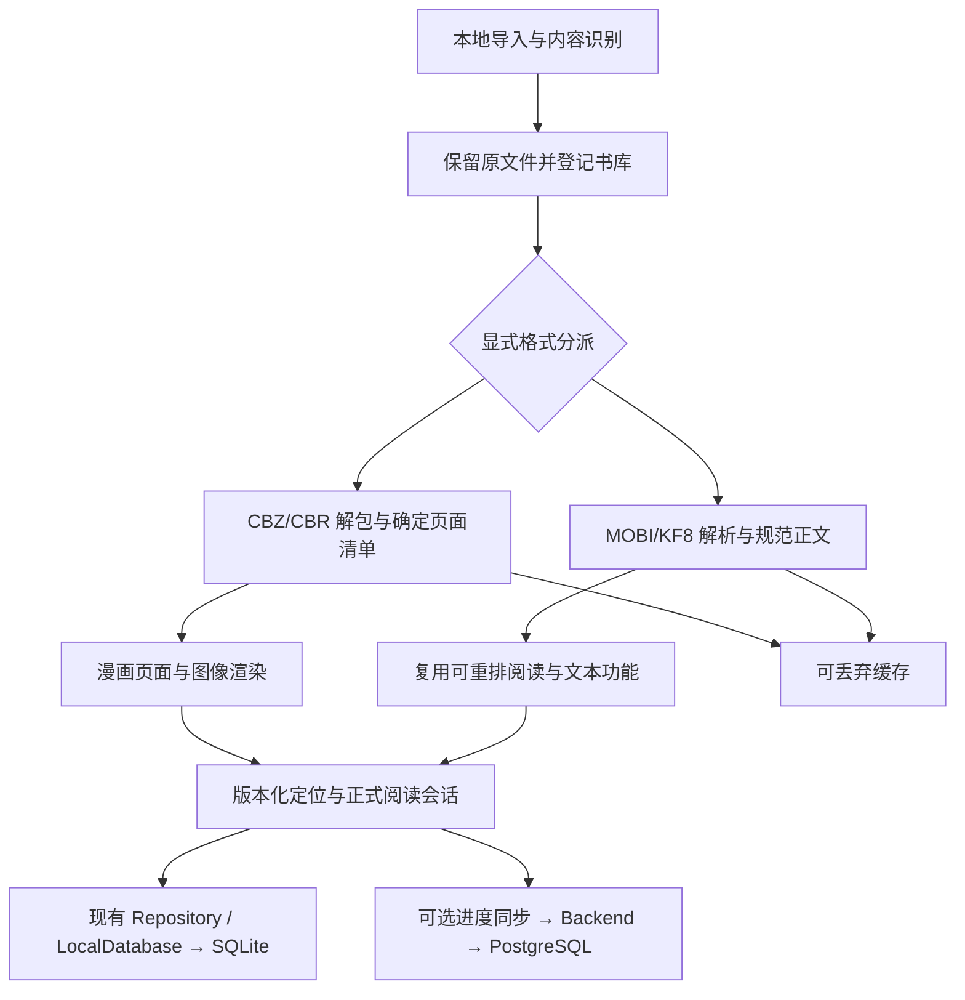

# 0.14.1 电子书格式扩展设计

状态：漫画与 Kindle 双端功能及公共部分已有实现：同源解析、规范定位、OpenAPI/Backend、PostgreSQL 004/005 与双端 SQLite v5。Kindle 具体算法及测试见 [规范](kindle-text-v1.md)和 [实施记录](../product/plans/0.14.1-kindle-implementation.md)。Android 宿主/六原包坐标及真实双端五阶段接续已通过，见[联合记录](../product/plans/0.14.1-kindle-cross-client-validation.md)；完整整版/真机预算仍未关闭。漫画证据见 [实施记录](../product/plans/0.14.1-comic-implementation.md)，产品范围见 [需求](../product/plans/0.14.1.md)，机器/存储真相见 [OpenAPI](../../contracts/openapi.yaml) 和 [Local Storage Contract](local-storage-contract.md)。

本版按 [Decision 0019](../product/decisions/0019-parallel-clients-txt-ui-baseline.md)修订：双端同批并行，全部公共新增/修改归 iOS agent，界面/操作沿用本端当前 TXT 阅读器。需求版本变更不改变 locator version/profile 的含义或自动升级组件版本。

## 1. 实施前基线与需要解决的问题（非当前完成状态）

| 边界 | 当前证据 | 0.14.1 要做的事 |
|---|---|---|
| Android 导入 | `DocumentFormats.detect` 将 PK 开头归为 EPUB，其他内容可能回退 TXT | 按签名及结构识别，不能只扩展后缀 |
| iOS 导入 | `LibraryStore` 识别 PDF/ZIP 后验证 EPUB，其余走 TXT | 同样区分漫画 ZIP、EPUB 与未知容器 |
| Android 阅读入口 | `DocumentReaderActivity` 在 EPUB 以外默认打开 PDF | 显式穷举支持类型，未知格式显示错误 |
| 定位 | Java/AppleShared `DocumentLocator` 只有 PDF/EPUB | 增加漫画、Kindle 的独立类型；保持旧编码不变 |
| SQLite | 双端 v3 的 books / document_positions / document_bookmarks 有格式和版本 CHECK | 无损迁移约束和 typed 列，不能只修改枚举 |
| 服务 | `document-progress.ts`、OpenAPI 只校验 PDF/EPUB；PostgreSQL 使用 document_progress | 协同扩展校验/派生进度/约束及测试；不改 TXT v1 |

上表保留设计时问题来源。当前固定 libarchive 3.8.9；用户已批准官方 UnRAR，新增固定 7.23 正式版只读解码补齐 RAR4 固实，保留 libarchive 的严格元数据校验，ZIP/RAR5 路径不变。源校验和、许可与边界见 [RAR4 接入说明](../../packages/native-archive/RAR4-SOLID.md)。公共核心已通过 Apple 三目标编译、ASan/UBSan 1024 例有界变异回归，以及 NDK 27.2 / API 23 三 ABI 编译、配对解码器链接和开发探针 16 KiB ELF 对齐检查；后者不替代 Android 最终 JNI/APK/设备、真机预算和联合验收，详见 [NDK 证据](../../packages/native-archive/ANDROID.md)。0.13 既有实现、验收与版本不因本次开发被覆盖。

## 2. 最小架构与职责



- 保留现有书库、设置、书签、会话和同步编排边界。增加两类实际需要的内容实现，不重写 TXT/PDF/EPUB，也不为每个后缀新增 Repository。
- 漫画内容提供页数、确定页序、按页读取及尺寸信息；解包不负责 UI 或正式阅读时间。
- Kindle 内容提供规范正文、内容单元/目录、资源读取及文本映射；正文解析不负责云端裁决。
- Android 可复用 ZIP 读取能力、现有工作队列和阅读会话；iOS 可复用 AppleShared 的无 UI 逻辑、原生图像和 WKWebView。共享模型有实际需求才提取小接口，不为形式增加 Adapter/Store/插件框架。
- CBZ 与 CBR 共用页面阅读器；MOBI/AZW/AZW3 共用正文阅读器。可复用 EPUB 的排版/选文组件，但不能将转换结果冒充原始 EPUB 的身份或沿用其 locator。
- 分派格式值为 `txt / pdf / epub / cbz / cbr / kindle`。Kindle 的源后缀保留在既有 sourceName，实际内容模式由解析结果确定；同一字节改 `.mobi`、`.azw` 或 `.azw3` 不产生不同 format。

### 2.1 并行开发及公共边界

Android 与 iOS 并行进行内容识别/解析 POC、渲染、本地迁移、UI 及测试；按用户 2026-10-25 的 [Decision 0020](../product/decisions/0020-defer-device-validation.md)，需要 iPhone 的性能/压力/样本集中后置，不再以第一批完整设备验收阻塞第二批开发。公共正文/定位等依赖不变，不假冒验收通过。

iOS agent 唯一维护公共代码与定义：Backend、OpenAPI/API、PostgreSQL 迁移、共同数据/存储/定位合同、页序/正文 profile、公共解析核心和依赖版本/许可、共享夹具/包、根脚本/CI 及共同文档。Android agent 维护本端实现、本地 SQLite 迁移、JNI/Gradle 接入和测试、本端说明，消费并复验公共产物。iOS agent 同时实现本端 Swift 桥接/数据库/UI。公共资产按契约/夹具版本交付，Android 发现偏差反馈给 iOS 修正，不并行抢写同一公共文件。

公共合同和服务开发与客户端开发并行；可用隔离测试替身验证客户端，但不把替身当作上线协议或验收服务。需要稳定坐标的正式持久化和真实上传，仍等待对应规范/机器契约及服务验证就绪。该依赖只约束相关功能，不暂停另一端全部开发。

### 2.2 TXT 界面与操作复用（R014-15）

各端以当前 TXT 阅读器为唯一界面/交互基线，复用既有阅读外壳与菜单、按钮、弹窗、主题、进度选择及返回/取消逻辑。Android 对照 Android TXT，iOS 对照 iOS TXT，保留 iOS 双滚轮及“前往”等已确认差异，不要求跨平台控件完全一致。

新的解析/渲染部件只提供内容与事件，不携带另一套默认工具栏。格式专属的缩放、适宽、页码等操作在既有样式和操作框架内扩展；不改动 TXT 既有同步/临时阅读语义来适配第三方控件。优先提取已存在的公共界面组件，不为此重做全局设计系统。

实现前记录本端 TXT 的基线提交、实际组件和截图；逐页核对布局、按钮尺寸/圆角/间距/图标/状态、菜单显隐、主题、加载/错误/空状态与手势/操作顺序。每批提供对照截图和操作回归，界面验收不能仅凭解析成功或编译通过。

## 3. 导入、识别与失败原子性

1. 文件选择/MIME 仅用于入口过滤，后台完整复制到临时文件，计算原始 SHA-256 和大小；不上传原书。
2. 内容识别优先于后缀：PDF 签名；ZIP 内 EPUB 必需结构；CBZ 的图片集合；RAR 签名/头；Palm/MOBI/KF8 结构。普通 ZIP/DOCX、KFX、其他二进制不能被当作 TXT。TXT 仍须通过原有编码验证。
3. ZIP 同时含完整 EPUB 结构和漫画图片时优先识别 EPUB；声明 `.epub` 却结构损坏时报告损坏 EPUB，不偷偷变成漫画。RAR 仅有可支持页面才作为 CBR。后缀与类型明显冲突时明确提示，不静默错误分派。
4. 检查 DRM、加密/分卷、资源上限和内容集合；MOBI 混合文件统一选 KF8，有但无法可靠解析时明确失败，不静默退回 MOBI6。
5. 完成最低必要内容验证、建立稳定清单后，原子发布应用副本及 SQLite 记录；沿用现有补偿/待删流程。取消、磁盘不足、CRC/结构错误不发布半成品记录。

新建书籍的真实阅读时间为未知，不因哈希、解包或建立第一页而设为现在。坏文件/不支持类型不覆盖已存在书籍的进度。删除本地书只清理其本地关联数据和可重建缓存，不隐式删除云端进度。

## 4. 第一批：漫画页面模型

### 4.1 共同子集与确定顺序（comic-order-v1）

- CBZ 支持 ZIP 的 store/deflate；CBR 目标为 RAR4/RAR5 的已验证无加密单卷子集，包含固实/非固实样本。新算法、分卷、加密、SFX 明确报不支持。
- 页面为 JPEG/PNG；按扩展名筛选并验证内容签名。其他已识别图片格式明确报不支持，不默默跳页。普通说明文件不当页面；不递归打开嵌套压缩包。
- 所有条目先安全解码：ZIP 按 UTF-8 标记/有效 Unicode 路径字段，缺少时按 CP437；RAR 使用有效 Unicode 名称。无法无损确定名称或字段冲突时拒绝，不用平台默认编码猜测。
- 名称转 Unicode NFC；拒绝绝对路径、反斜线、空组件、`.`/`..`、控制字符、盘符及链接条目；规范化后出现同名条目即拒绝。解包输出使用生成的资源 ID，不直接拿条目名当磁盘路径。
- 任一路径组件以 `.` 开头，或为 `__MACOSX` 的条目不进入页面集合。过滤后无页面即报告空漫画。
- 按路径组件从根到叶比较；组件按 ASCII 数字串和非数字串分段。数字串以去前导零后的长度、数字序比较，不转换为有溢出风险的整数；非数字串仅 ASCII A–Z 转小写后按 Unicode 标量比较。数值相等继续比较后续段；前缀短者先。全部排序键相等时，按完整 NFC 路径的原始 Unicode 标量序打破平局。禁用系统本地化排序。
- `pageKey = lowercaseHex(SHA256(UTF8(canonicalPath)))`；有序页面的 `manifestHash = SHA256(UTF8("xlib-comic-order-v1\n" + 每个 pageKey 后接 LF))`。路径只在本地，线上只发送不透明哈希。排序/规范变更须升 profile，不能沿用旧 profile 改页序。
- ComicInfo.xml 在首期不控制顺序、方向或双页合并，避免引入第二套页序；不因某端解析了元数据而改变跨端坐标。

比较器、路径编码和清单哈希的参考输出已实现于 AppleShared / 固定核心及共享夹具；各端消费同一输出，不分别“近似实现”。第一批 G0/G1 仍需公共核心双端构建、覆盖范围及联合接续等完整证据，不能由单项测试代替。

### 4.2 渲染、方向与缓存

默认单图单页、左到右导航；可在本地设置中选择右到左，设置只影响前后翻页的手势/视觉方向，页面逻辑序号始终递增，不翻转原图。方向经 SettingsRepository/现有 typed 设置边界存入 SQLite。双页拼接、自动拆图和连续条漫模式不在首期。

支持整页/适宽、缩放与长图纵向查看。页内锚点按图像 EXIF 方向校正后的自然顶部纵坐标定义；横向平移和缩放倍率为会话视图状态，不跨设备同步。重开以可显示锚点恢复，不能因新的视口高度覆盖保存的锚点。单纯缩放/旋转布局不记阅读事件。

按目标尺寸采样解码，只预取当前和相邻页面，内存预算按解码后的像素字节计。巨图使用区域/瓦片或进一步下采样，禁止先解码完整原图再缩小；若特定编码无法满足内存预算，应受控失败。解包字节缓存与解码图像缓存分别限额；不能以仅限制缓存条目数控制内存。

固实 CBR 可能需要顺序推进解压才能取得后页，应使用一个可取消的解压任务和受限磁盘缓存，显示准备状态，避免每次跳页从头阻塞主线程；不同时保留全部解码图像。缓存淘汰后允许重新解压，正式位置不依赖缓存存活。CRC/图片损坏不静默删除该页并重排。

## 5. 第二批：Kindle 解析与规范正文

### 5.1 解析、渲染与共同输出

目标为无 DRM 的可重排 MOBI6/KF8，以及含两者的混合文件；AZW 是别名入口，不把所有 AZW 当作同一种内部结构。识别 DRM 与不支持的容器/固定版式后给出不同原因。无需账号、网络转换或外部命令。

采用同一固定 foliate-js 非 DOM 解码源与项目规范化核心 `packages/kindle-core`，宿主接口为 `XLibKindle.parse({size,read},cancelled)`。Apple 用 JavaScriptCore；Android 可用支持 Uint8Array/TextDecoder 的隔离 JavaScript 宿主，不能以第二套解析器定义正文。此方案不需要虚构 C ABI/JNI 或 Kindle ELF；Android 引擎选择、原生引擎打包的 API23/三 ABI/16 KiB 合规及实际同源向量由其本端验证。桥接只负责读取、编码、错误、取消和资源边界，不增加业务存储。

排版使用经过净化的本地 HTML/图片；不执行脚本、插件、附件和远端请求。建立规范文本到显示 DOM/原始内容的双向映射，目录、链接、搜索命中、选文和正式锚点共用该映射，不能分别取 WebView.innerText 和解析器文本而产生两个真值。

### 5.2 内容锚点（kindle-text-v1 参考实现）

采用出版物范围的规范文本 UTF-16 偏移；内容单元索引负责快速查找，不作为另一种权威位置。当前实现随机读取记录，但在硬限额内保留选定展开正文、规范文本和净化 HTML；不是整书低内存流式排版。后续可在不改变 profile 真值的前提下优化分块生成/查询，不能把该优化方向当作已实现内存保证。

规范方向：按选定正文的出版顺序遍历，排除 script/style/非正文活动内容，解码实体，换行统一 LF，保留文本 Unicode（不对正文做 NFC/NFKC），图像占一个 U+FFFC 位置，内容单元间插入一个 LF。普通文本空白折叠、pre 空白、块元素分隔、不可见节点及尾部换行必须在共享测试向量中逐项确定。DOM 和文本映射由同一规范处理生成。

`textHash = SHA256(UTF8(canonicalText))`；textOffset/textLength 按 UTF-16 code unit 计，offset 不切开代理对/组合字符；textLength > 0 且不超过 2^31-1。图片位置可用于显示/定位，但搜索不把占位符当作正文，复制不将占位符暴露为文字。

六个完整原包及其模式、规范正文、textHash、章节/目录/跨度映射已落地 `contracts/fixtures/documents/kindle-*`。Node/JSC/Android 同源向量、两端实际 DOM/图片/选区及真实五阶段接续已验证，双端使用该 profile 正式持久化/同步；不声称完整设备/G2/G3 完成。具体空白、实体、映射和限制以 [kindle-text-v1](kindle-text-v1.md) 为准；语义不原地改变，后续变更须新 profile 和显式迁移。

## 6. 当前开发定位合同（已进入 OpenAPI/Backend，未部署）

漫画示例：

```json
{
  "format": "cbz", "version": 1, "profile": "comic-order-v1",
  "manifestHash": "aaaaaaaaaaaaaaaaaaaaaaaaaaaaaaaaaaaaaaaaaaaaaaaaaaaaaaaaaaaaaaaa",
  "pageKey": "bbbbbbbbbbbbbbbbbbbbbbbbbbbbbbbbbbbbbbbbbbbbbbbbbbbbbbbbbbbbbbbb",
  "page": 1, "pageCount": 3, "y": 0.25
}
```

- format 为 cbz/cbr；page 从 0 起，0 <= page < pageCount，pageCount 为 1–10000；y 为自然顶部纵坐标比例，0–1，四舍五入六位小数。
- 应用前核对原文件身份、profile、manifestHash、pageCount、page 与 pageKey 的对应关系；仅后端校验范围不足以证明可用。
- 漫画进度采用当前页占总页数：`(page + 1) / pageCount`，同一页的 y 只用于精确恢复，不改变页级百分比；未读状态由未知阅读时间表达。第一页不承诺显示 0%，单页打开可显示 100%，均不因此制造阅读时间。与 PDF 的旧公式不同，不能改动 PDF 语义。
- 书签规范位置键包含格式、版本、profile、manifestHash、pageKey、固定六位 y。排序、判重和导航使用同一规范化结果。

Kindle 示例：

```json
{
  "format": "kindle", "version": 1, "profile": "kindle-text-v1",
  "textHash": "cccccccccccccccccccccccccccccccccccccccccccccccccccccccccccccccc",
  "textOffset": 120, "textLength": 1000
}
```

- 0 <= textOffset <= textLength，textLength 为 1–2147483647；进度为 textOffset/textLength。客户端验证 UTF-16 内容边界及 textHash，后端验证字段/数值。
- 书签位置键包含格式、版本、profile、textHash、textOffset，不以比例或当前章节屏幕页号判重。同一源文件改名不改变 hash/格式/profile。
- 哈希均为 64 位小写十六进制。严格拒绝未知字段、版本、profile、非有限数和越界；不接受本地路径、页面文件名或正文片段。

漫画字段已进入机器契约及 PostgreSQL 004；Kindle 字段进入 OpenAPI、Backend 与新增 PostgreSQL 005，参考输出不得原地改义。一旦正式持久化，定位版本/profile 不允许原地改变意义。旧 PDF/EPUB locator v1、TXT v1 完全保留原义。

## 7. 本地数据与迁移方案

继续只有：SQLite 保存结构化业务/设置，文件系统保留原书与可丢弃缓存，平台安全存储保留凭据。禁止增加 JSON/Preferences/UserDefaults 业务存储。

实际 iOS 版本为 v3→v4 漫画→v5 Kindle；v3 可直接无损迁移到 v5，v4 保留全部漫画 typed 列。Android 的版本和测试由本端记录，不能仅改 pragma 冒充迁移。

| 数据 | 开发实现 |
|---|---|
| books | format CHECK 增加 cbz/cbr/kindle；保留本地 ID、sourceName、用户编辑 metadata、原路径、哈希及所有旧值 |
| document_positions | 在既有类型化列扩展 profile、manifest_hash、page_key、text_hash；漫画复用 page_index/page_count/页内锚点列，Kindle 使用 text_offset/text_length；旧类型不填新字段 |
| document_bookmarks | 同样扩展 typed 坐标与位置键；保持旧 ID、时间、摘录及旧位置键，不因升级去重/清空历史记录 |
| settings | 增加漫画阅读方向等非敏感键；通过现有 typed 设置访问边界，不新建独立设置 Store |
| 同步缓存 | 仍分离 TXT 和 typed 文档状态，保留新定位/profile；不得把它作为本地正式进度的第二权威源 |

按格式设置有效字段组合的 CHECK/读取校验；源格式与 locator 格式必须匹配。不要仅添加可空列却允许漫画写入 EPUB resource 等非法组合。不存规范正文/图片 BLOB 到业务表；规范文本、清单、解包页、缩略图和搜索索引可以作为带源哈希/profile 的可重建缓存。缓存序列化不是业务持久化例外扩张。

SQLite 修改 CHECK 所需的表重建必须在事务中复制并验证行数/值/外键/唯一约束后替换，处理 Android/iOS 自有 ID 和列名差异。失败回滚，禁止清库、降级破坏性重建或复活旧 JSON fallback。重复打开不重复迁移，进程终止/磁盘满不丢旧记录。原文件删除继续使用现有待删机制。

清缓存后从原文件重建相同 manifestHash/textHash。不能重建或不匹配时保留书签/正式位置并提示不可应用；不回退 0%、不修改阅读时间。解析器升级的派生缓存版本与稳定定位 profile 分开管理。

## 8. API、Backend 与混合版本兼容

优先扩展现有 `GET/POST/DELETE /v2/progress...` 及 DocumentLocator 联合类型，不新增逐后缀端点、不改变身份认证/时间裁决。保持原始 SHA-256 + fileSize 为键，Backend 继续 PostgreSQL document_progress。

- 同一源文件既有状态与候选的 format/version/profile，以及相应 manifestHash/textHash 不一致时明确拒绝；不能因候选时间较新就覆盖不兼容正文/页序。业务时间比较和设备 UID 的同时间裁决不变。
- 后端从新定位派生进度，拒绝多余字段/重复身份/非法范围。不要用客户端传入的百分比替代校验。
- 当前 `003_document_progress.sql` 的 CHECK 将 locator.format 限定为 pdf/epub，因此实施必须新增编号迁移扩展约束并验证旧数据/受限角色；不能编辑已执行的迁移。若届时基线已有其他迁移，先复核并延续编号。Backend 保持 PostgreSQL，不新建逐后缀业务表。
- 先提交 OpenAPI、docs/API、服务校验/读取/派生/冲突规则和真实 PostgreSQL 测试，再联调移动端。兼容实现部署另行授权；离线功能不等待服务可用。
- 旧服务拒绝新定位时，新客户端保留本地阅读，明确显示新格式同步不可用，不回退 v1/PDF/EPUB、不反复上传。网络/服务恢复后仍先比较；未知远端定位保留原本地位置和时间，停止该书上传直至可解释，不能按“没有云端记录”处理。
- 旧客户端不会因一次全书库拉取收到新格式：v1 本就隔离，v2 为按原文件读取。但旧端主动读取到不支持定位时仍需测试其安全失败行为，不能仅凭路由推断兼容。
- 漫画/Kindle 的阅读前比较、双方百分比、接受/拒绝跳转、只上传活动书、单书删除暂停均复用原会话规则。准备/重建缓存/加载页期间没有正式阅读写入。

当前 OpenAPI、Backend、docs/API、005 迁移与真实 PostgreSQL 测试已协同更新；发布/部署另行授权。客户端与服务源码实现不等于全部跨端/设备验收。

## 9. 依赖方案与核验门槛

| 部件 | 优先验证方案 | 必须验证后才能定版 |
|---|---|---|
| CBZ | 复用已有 ZIP 能力和平台图像解码 | ZIP64/编码、CRC、大小限制、非预期 ZIP 分类；无需单独引入整套办公引擎 |
| CBR | libarchive 3.8.9；RAR4 使用严格元数据解析 + 官方 UnRAR 7.23 内存解码，RAR5 保留 libarchive；双端消费同一固定核心 | Android JNI/16 KiB 内存页兼容、iOS 真机/模拟器架构、固实跳页、版本/方法覆盖、取消/内存上限及依赖许可清单；UnRAR 特定许可全文与限制声明必须随分发保留 |
| Kindle | foliate-js 非 DOM MOBI 解码 + 同源 `packages/kindle-core`；MIT | commit `78914aef4466eb960965702401634c2cb348e9b1`，来源 SHA-256/适配/许可见包 README；六原包、Node/JSC/Android/DOM、API/PG 和实际双端接续通过；设备预算仍待验证 |

libarchive 官方列出 RAR/RAR5 读取但带兼容限制，不能承诺所有 RAR 算法；固实包需保留前序解压字典。Kindle 未引入原候选 libmobi/LGPL，使用 MIT foliate-js 的解码部分，保留完整版权/许可于源码、AppleShared 与 iOS 资源。没有导入其第三方阅读 UI、DOM 浏览器转换或网络服务。支持/拒绝子集和安全限额见专门规范，不承诺所有出版商变体。

原生依赖固定版本/校验和，只启用必要解码功能，检查传递依赖、漏洞及发布说明；不默认引入整套 libarchive 全部格式或下载运行外部命令。设计尚未证明候选库已适合本项目，不添加虚假的完成状态。

## 10. 资源限制、并发与验证

以下为 POC 初始预算，尚非实测结论；G0/第二批准备时依据设备测量固定公共支持限额及明确错误文案。两端不得私自跳页来适应更低限额。

| 项目 | 初始设计预算 |
|---|---|
| 原文件 | <= 1 GiB，超过明确提示；流式哈希/读取 |
| 压缩包 | <= 20000 条目、10000 页面、累计实际解压 <= 4 GiB、单条 <= 128 MiB；同时校验声明值和实际写出值 |
| 图片 | 先读尺寸和方向；> 1 亿像素拒绝；解码图像缓存 <= 64 MiB，解码临时峰值另测；适配图不能先完整解码巨图 |
| 可丢弃磁盘缓存 | 初始每书 <= 512 MiB、全局 <= 1 GiB LRU；同时保留系统可用空间余量；不含原文件/SQLite |
| 固实解压字典 | POC 目标 <= 64 MiB，超预算方法明确不支持；与页面解码合计峰值必须测量 |

图像缓存、原生解压字典、WebView/系统框架和进程总内存分开报告；不能用缓存预算冒充进程峰值。缓存缺页允许重读，磁盘缓存不足时取消准备并保留位置，不能永久丢弃原文件。

I/O、解压、文本规范、哈希和搜索都在后台执行，使用现有任务/会话代次拒绝旧结果；快速切书、反向跳页、关闭后重开不能让前一任务写进度或展示旧页。原生操作支持协作取消；暂不可中断的调用需限流并在结果发布前校验代次。限制实际展开字节、路径、XML 实体与 HTML 资源访问，不相信压缩包声明大小。

实施时在 `contracts/fixtures/documents/` 增加可再分发夹具和预期向量；本次不创建空样本。至少覆盖：

- 漫画排序、编码、隐藏项、相同数值/不同补零、NFC 冲突、路径攻击、坏图片、GIF/WebP 等非首期图片、RAR4/RAR5/固实/未知方法/分卷/加密。
- Kindle MOBI6/KF8/混合、同字节不同后缀、DRM 拒绝、缺目录、正文实体/空白/pre/图像占位符/组合字符、超长内容单元、搜索/复制与锚点映射。
- Java/Swift/Backend 同一定位编码、进度公式、错误输入和 profile/hash 不匹配；SQLite 升级前后 TXT/PDF/EPUB 与设置全量不变、迁移重复执行/中断/磁盘满。
- 双端同源文件双向接续、准备期零上传、单书删除暂停、旧服务/旧客户端安全失败、后台/取消和快速切书。
- 固定小/大样本至少三轮，记录导入总耗时、首屏、缓存命中/清除后首屏、随机远跳、长图缩放、搜索首结果/全量/取消、峰值内存/磁盘与重复切书。绝对延迟阈值在首个 POC 数据后确定；没有阈值和设备证据不得称性能验收通过。

正常实现执行 `make check`；涉及同步与数据库执行 `make test-backend-postgres`；Alpha 准备前执行 `make check-alpha`，再追加相关设备/大样本测试。单元测试通过不替代格式兼容/真机性能验收。

## 11. 技术资料与适用范围

调研于 2026-10-24，以下用于方案依据，不代表已完成本项目适配：

- [libarchive 格式说明](https://github.com/libarchive/libarchive/wiki/LibarchiveFormats)：支持范围需按实际构建启用的模块核验。
- [libarchive 项目](https://github.com/libarchive/libarchive)及[许可文件](https://github.com/libarchive/libarchive/blob/master/COPYING)：选定版本及传递依赖需一并核对。
- [RAR 官方格式说明](https://www.rarlab.com/technote.htm)：固实、分卷、加密及方法限制。
- [foliate-js 固定版本](https://github.com/johnfactotum/foliate-js/tree/78914aef4466eb960965702401634c2cb348e9b1)：选用 MIT 非 DOM MOBI 解码部分；不作为 DRM 支持承诺。
